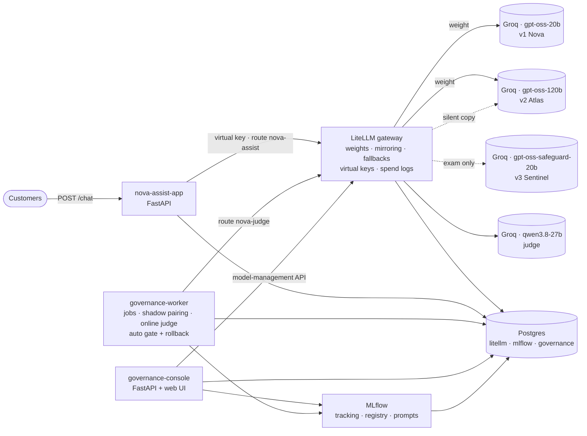

# Model Governance Crash Course: NovaBank "Nova Assist"

A complete, runnable mini project for teaching **model governance**: how a company decides which AI model goes to production, proves it is good enough, rolls it out with control and keeps an audit trail.

**The story.** NovaBank, a fictional digital bank, runs a customer-support chatbot, *Nova Assist*. **Nova (v1)** is live. The product team proposes **two candidates**: **Atlas (v2)**, a bigger model, and **Sentinel (v3)**, a safety-tuned one. The governance board says: *"Prove it, roll it out safely, and keep an audit trail."* Over a seven-week story the change goes through a proposal, an exam (Atlas passes, Sentinel is rejected), a shadow week, a canary week and a weekly rollout (25% → 50% → 100%), ending in promotion or rollback.

- **The console** (a web app) is the practical side: each chapter of the story is a page with buttons, a live architecture diagram and the evidence. **After setup, everything happens in the browser.**
- **[DEMO.md](DEMO.md)** is the instructor guide: simple theory plus step-by-step *do this → what happens → why* for every chapter.

## Setup (the only terminal commands)

**You need:** [Docker Desktop](https://www.docker.com/products/docker-desktop/) running (give it at least 6 GB RAM, about 6 GB free disk) and a free **Groq API key** from <https://console.groq.com/keys>.

```bash
git clone <your-repo-url> model-governance && cd model-governance
cp .env.example .env            # open .env and paste your key after GROQ_API_KEY=
docker compose up -d --build    # first build takes about 5-10 minutes
```

Wait about a minute after the containers start (the worker sets up Week 0 by itself), then open **<http://localhost:8501>**.

**Check it works:** in the console, open **System check**:
1. All four services show *Healthy*.
2. **Live check** makes one tiny real call to each model and shows OK.
3. **Rehearse the whole story** plays all seven weeks automatically (about 2 minutes, about 11 real Groq calls), shows OK for every chapter, and resets to Week 0.

Then follow [DEMO.md](DEMO.md).

## The UIs

| UI | URL | Login |
|---|---|---|
| **Governance console** (teach from here) | <http://localhost:8501> | none: pick a name and role in the top bar |
| MLflow (runs, Model Registry, Prompt Registry) | <http://localhost:5000> | none |
| LiteLLM admin (routes, keys, spend logs) | <http://localhost:4000/ui> | user `admin`, password = `LITELLM_MASTER_KEY` in `.env` (default `sk-nova-master-local`) |
| Nova Assist API (Swagger) | <http://localhost:8000/docs> | none |

## Real calls vs simulated data

The console runs in **classroom simulation mode** by default (`simulation.enabled: true` in `governance/policy.yaml`):

- **About 11 real Groq calls for the whole story.** One or two per chapter really go through the gateway and are really answered, mirrored, routed and judged.
- **The bulk is simulated.** Each traffic week is 10,000 questions, and the exam has 141 of its 142 examples per model simulated. `governance/simulate.py` generates them from **invented teaching profiles**, so they are not measurements of the real models.
- **The machinery is real:** gateway weights and mirroring, model registry and aliases, gates, approvals, human review, automatic rollback, the hash-chained audit log and the report.
- **Every simulated record is labelled** (`simulated = true`, `source: simulated`, a console badge) and never enters LiteLLM's or MLflow's own records.

Set `simulation.enabled: false` (on the console's **Governance policy** page) to run everything for real, and size the volumes to your quota.

## Architecture



| Service | Role |
|---|---|
| `postgres` | Three databases: `litellm` (gateway state, spend logs), `mlflow` (tracking, registry), `governance` (audit log, gate decisions, requests, shadow pairs, jobs) |
| `litellm` | The only path to Groq. Fixed routes `nova-v1/v2/v3` and `nova-judge` are in `litellm_config.yaml`; the governed production route `nova-assist` lives in its database and is changed only by the console |
| `mlflow` | Model Registry (`nova-assist` with `@champion` / `@challenger` / `@retired`), Prompt Registry, evaluation runs |
| `nova-assist-app` | The "production" chatbot API. It holds only its own virtual key (no Groq key) and tags every request with an ID and the traffic window |
| `governance-worker` | Sets up Week 0, runs jobs (exam, simulated weeks, drift, rehearsal), pairs and judges shadow traffic, and re-checks the live gate every 15 s with automatic rollback |
| `governance-console` | The web console: one page per chapter, audit log, policy editor, system check. Every button calls the governed functions in `governance/lifecycle.py` |

## Honesty note: what is native and what we built

| Need | How | Native? |
|---|---|---|
| Traffic split for canary and rollout | LiteLLM router `weight` on the DB-stored `nova-assist` route, changed through its model-management API | Native |
| Shadow mirroring | LiteLLM `silent_model`. The worker pairs each copy with the customer's request by `request_id` (copied into `spend_logs_metadata`). LiteLLM drops failed copies without logging them, so missing copies count as challenger errors | Native + our pairing |
| Retries, fallbacks, virtual keys, budgets, spend logs | LiteLLM open-source proxy | Native |
| Registry, aliases, Prompt Registry, runs, datasets | MLflow 3.18 | Native |
| Evaluation metrics | DeepEval 4.3.3 with a small adapter (`GatewayJudge`) so the judge is called through our gateway | Native metrics + our adapter |
| Classroom volumes | `governance/simulate.py`, seeded and labelled | Built (simulated by design) |
| Gates, automatic rollback, hash-chained append-only audit log, report, role approvals, rehearsal | `governance/`, `shadow/worker.py`, `postgres/init.sql` | Built |

We avoided the LiteLLM enterprise features (SSO, enterprise audit logs, guardrails, secret managers, tag budgets). Identity in the console is self-declared (name + role); a real deployment would use SSO. The role checks themselves are enforced from `policy.yaml → approvals`.

## Models

Model IDs are confirmed against Groq's `/models` and live only in `litellm_config.yaml`.

| Role | Model | Why |
|---|---|---|
| Champion v1 "Nova" | `openai/gpt-oss-20b` | Small, cheap, fast: a plausible first launch |
| Candidate v2 "Atlas" | `openai/gpt-oss-120b` | Same family, 6× larger, 2× price: "bigger must be better, prove it" |
| Candidate v3 "Sentinel" | `openai/gpt-oss-safeguard-20b` | Safety-tuned, same price as v1. Its teaching profile is over-cautious, so the exam rejects it |
| Judge | `qwen/qwen3.8-27b` | Different model family from the candidates, which limits self-preference bias |

**Groq free tier (measured):** 1,000 requests/day, 8,000 tokens/min, 1,000 output tokens/min and about 200,000 tokens/day per model. The simulation keeps a full lesson to about 11 calls. With simulation off, the judge is the bottleneck (about 8 calls/min). Use the `demo` evaluation profile (14 examples, about 8 min per model) or `lite`; finished examples are cached, so an interrupted exam resumes.

## Troubleshooting

| Symptom | Fix |
|---|---|
| `port is already allocated` | Another app uses 8501, 5000, 4000 or 8000. Stop it, or change the left side of that `ports:` entry in `docker-compose.yml`. On macOS, AirPlay Receiver uses port 5000. |
| Console says "Stack not reachable" | Wait a minute after `docker compose up`; the worker sets up Week 0 once LiteLLM and MLflow are healthy. `docker compose ps` shows each service's health. |
| Live check shows `401` / `invalid_api_key` | The key in `.env` is wrong. Fix it, then run `docker compose up -d --force-recreate litellm`. |
| Live check shows `429` / rate limit | The Groq free tier's per-minute or daily limit is reached. Wait a minute (or until the next day), or use another key. |
| The exam job fails with a rate-limit error | Click **Run the exam** again (simulation off only: finished examples are reused). |
| Start the story again | Console → **Chapter 0 → Reset to Week 0**. The audit log keeps everything, including the reset. |
| Wipe everything (audit log, MLflow, keys) | `docker compose down -v`, then `docker compose up -d`. |

## Repository layout

```
├── README.md                  # this file: setup and overview
├── DEMO.md                    # instructor guide: theory + step-by-step for every chapter
├── docker-compose.yml         # the six services
├── Dockerfile                 # image for app, worker and console
├── .env.example               # copy to .env and add your Groq key
├── litellm_config.yaml        # gateway routes, prices, retries, fallbacks
├── requirements.txt
├── app/                       # Nova Assist chatbot API + MLflow pyfunc model
├── console/                   # governance console: server.py (API) + static/ (web UI)
├── data/                      # golden, replay and red-team sets + dataset card
├── evaluation/run_eval.py     # DeepEval exam suite, offline and drift gates
├── governance/
│   ├── policy.yaml            # every gate threshold, story calendar, simulation profiles
│   ├── policy.md              # the chatbot's system prompt (bank policy)
│   ├── core.py                # gateway, audit log, gates, keys
│   ├── lifecycle.py           # every chapter as a governed function
│   ├── simulate.py            # classroom simulator (labelled synthetic data)
│   ├── rehearsal.py           # automatic end-to-end story rehearsal
│   └── report.py              # governance report for the board
├── postgres/init.sql          # governance schema, append-only audit triggers
├── proposals/                 # the proposal (two candidates) + a model card per candidate
├── reports/                   # generated reports (git-ignored)
└── shadow/worker.py           # governance worker
```

## Licences

The datasets are derived from [Bitext retail-banking](https://huggingface.co/datasets/bitext/Bitext-retail-banking-llm-chatbot-training-dataset) under CDLA-Sharing-1.0 (see `data/DATASET_CARD.md`). The red-team prompts were written for this course.
