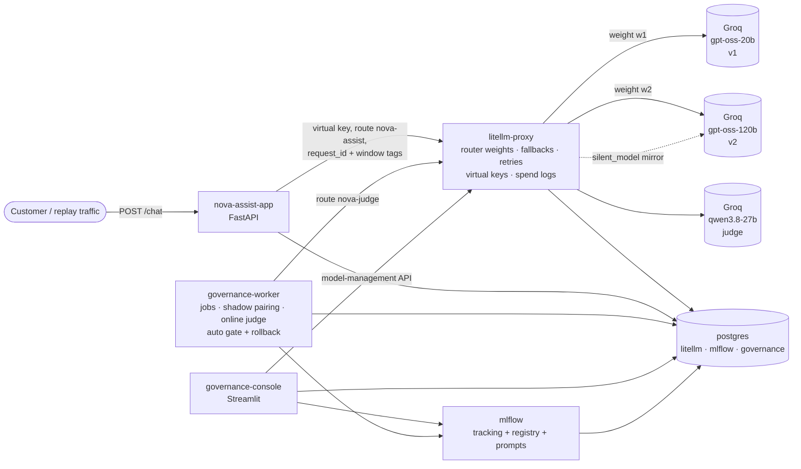

# Model Governance Crash Course: NovaBank "Nova Assist"

A complete, runnable mini project for teaching **model governance**: how a company decides which model goes to production, proves it is good enough, rolls it out with control and keeps an audit trail.

**Story.** NovaBank, a fictional digital bank, runs an LLM support assistant, *Nova Assist*. Version **v1** is live. The product team proposes **v2**. The governance board says: *"Prove it, roll it out safely, and keep an audit trail."* Students follow that one change from proposal to production, or to rollback.

Everything is real:
- Every model call hits the Groq API through a LiteLLM gateway.
- Every score comes from a real DeepEval run.
- Every traffic percentage is real routing by the gateway.
- Every decision is in a tamper-evident audit log.

> ## Honesty note: what is native and what we built
> | Need | How it is done | Native? |
> |---|---|---|
> | Traffic split (canary/rollout) | LiteLLM router `weight` on deployments of the `nova-assist` route, changed at runtime through LiteLLM's model-management API (`/model/new`, `/model/delete`, `store_model_in_db`) | **Native.** Models defined in `litellm_config.yaml` cannot be edited at runtime, so the governed production route lives in the LiteLLM DB. The console is the only thing that edits it. |
> | Shadow traffic mirroring | LiteLLM `silent_model` on the champion deployment | **Native.** We add pairing and judging: the worker matches each mirrored call in `LiteLLM_SpendLogs` to the customer's request by our `request_id` (which LiteLLM copies into `spend_logs_metadata`). The `is_silent_experiment` flag needs LiteLLM ≥ 1.109, and we pin the latest stable 1.108.0, so the worker does not rely on it. |
> | Fallbacks, retries, virtual keys with model allow-lists, RPM limits and budgets, spend and request logging to Postgres | LiteLLM open-source proxy | **Native** |
> | Model registry, aliases, Prompt Registry, runs, datasets, tables | MLflow 3.18 | **Native** |
> | Evaluation metrics (relevancy, G-Eval, toxicity, bias) | DeepEval 4.3.3 with a small custom-model adapter (`GatewayJudge`) so the judge is called through our gateway | **Native metrics.** We wrote the adapter, because DeepEval's `LiteLLMModel` would need a second copy of the LiteLLM SDK in the image. |
> | Gates, automatic rollback, append-only hash-chained audit log, governance report, approvals by role | Our own code: `governance/`, `shadow/worker.py`, `postgres/init.sql` | **Built.** No tool offers these. |
>
> **LiteLLM enterprise features deliberately avoided:** SSO for the admin UI, enterprise audit logs, team-based logging callbacks, guardrails, secret-manager integrations, tag-based budgets. This project uses only the open-source proxy. Our audit trail is our own Postgres table.
>
> **Identity is self-declared** in the console (name + role picker). A real deployment would put the console behind SSO. The role checks themselves are enforced from `governance/policy.yaml → approvals`.

## Quick start (3 commands)

Prerequisites: **Docker Desktop** (give it ≥ 6 GB RAM), a free **Groq API key** from <https://console.groq.com/keys>, and about 6 GB of disk for images.

```bash
git clone <this repo> model-governance-crash-course && cd model-governance-crash-course
cp .env.example .env          # then open .env and paste your key after GROQ_API_KEY=
docker compose up -d --build  # first build takes ~5-10 minutes
```

Then open the console at **<http://localhost:8501>**. Stage 0 bootstraps itself in about a minute after start: virtual keys, the prompt registered in MLflow, v1 registered as `@champion`, and 100% of traffic on v1. Everything else is done with buttons.

## The UIs

| UI | URL | Login |
|---|---|---|
| **Governance console** (drive the lesson here) | <http://localhost:8501> | none (pick a name + role in the sidebar) |
| MLflow (runs, Model Registry, Prompt Registry) | <http://localhost:5000> | none |
| LiteLLM admin UI (routes, keys, spend logs) | <http://localhost:4000/ui> | user `admin`, password = `LITELLM_MASTER_KEY` from `.env` (default `sk-nova-master-local`) |
| Nova Assist API (Swagger) | <http://localhost:8000/docs> | none |

## Architecture



| Service | Role |
|---|---|
| `postgres` | One server, three databases: `litellm` (gateway state + spend logs), `mlflow` (tracking + registry), `governance` (audit log, gate decisions, requests, shadow pairs, jobs) |
| `litellm` | The only path to Groq. Fixed routes `nova-v1`, `nova-v2` and `nova-judge` live in `litellm_config.yaml`. The governed production route `nova-assist` lives in the DB. |
| `mlflow` | Tracking server, Model Registry (`nova-assist` with `@champion` / `@challenger` / `@retired`) and Prompt Registry (`nova-assist-system`) |
| `nova-assist-app` | The "production application". It only holds its own virtual key (no Groq key, no master key) and tags every request with `request_id` and the traffic window. |
| `governance-worker` | Bootstraps Stage 0. Runs evaluation and replay jobs. Pairs and judges shadow traffic, judges sampled live answers, and re-checks the live gate every 30 s with automatic rollback. |
| `governance-console` | One page per stage, plus the audit log and policy editor |

**Health:** every service has a Docker health check. Run `docker compose ps` (all should say `healthy` or `Up`), or open the console's **Overview** page, which shows each service's status and can make one live call per model.

## Models

Chosen after calling Groq's `/models` with the course key (November 2026). Model IDs live only in `litellm_config.yaml`.

| Role | Model | Why |
|---|---|---|
| Champion v1 | `openai/gpt-oss-20b` | Small and cheap ($0.075 / $0.30 per 1M tokens in/out), fast, a plausible "first launch" model |
| Challenger v2 | `openai/gpt-oss-120b` | Same family, 6× larger, 2× price: the classic "bigger must be better, prove it" proposal |
| Judge | `qwen/qwen3.8-27b` | A different model family from both candidates, which reduces self-preference bias. It is the only other capable chat model on the key. `reasoning_format: hidden` keeps its output to clean JSON. |

Trade-off: the judge is a preview model on Groq and can change or disappear. If it does, change the `nova-judge` route in `litellm_config.yaml` and note that past and new scores are not comparable.

## Groq free-tier limits and run times

Measured from response headers for this key: **1,000 requests/day and 8,000 tokens/minute per model** (Groq documents about 200K tokens/day). The judge is the bottleneck. How the project fits inside the limits:
- Gateway retries with `retry_after`, plus client-side exponential backoff with jitter (`rate_limits` in `policy.yaml`).
- A concurrency of 2.
- Per-key RPM limits.
- A small default evaluation profile.
- Per-example results saved to Postgres, so an interrupted evaluation resumes instead of re-spending tokens.

| Step | Groq calls (approx.) | Time on the free tier |
|---|---|---|
| Stage 2 offline eval, `lite` profile (27 golden + 12 red-team, both versions) | ~80 answers + ~450 judge calls | 35–45 min. **Run it before class.** Re-runs reuse cached examples and finish in seconds. |
| Stage 4 shadow (45 requests) | 45 v1 + 45 v2 + 45 judge | ~3 min |
| Stage 5 canary (120 requests at 10%) | 120 answers + ~25 judge | ~5 min |
| Stage 6 rollout (25/50/100%) | ~80 answers + ~60 judge | ~6 min |
| Drift check | same as one version of Stage 2, fresh calls | ~20 min |

The `full` profile (130 golden examples) needs about 5× the judge tokens, which means a paid tier or a run spread over several days. Switch profiles under `evaluation.profile` on the console's Policy page.

## Running the tests

The integration tests hit the real stack (gateway routes, key restrictions, registry aliases, gate logic, the append-only audit log, rollback, and every console page). They make a handful of real Groq calls.

```bash
docker compose exec governance-console pytest -q tests
```

## Troubleshooting

| Symptom | Fix |
|---|---|
| `port is already allocated` | Another app uses 8501, 5000, 4000 or 8000. Stop it, or change the left side of the `ports:` mapping in `docker-compose.yml`. On macOS, AirPlay Receiver uses port 5000. |
| Console says "Stack not ready" | Wait about a minute after `up`, then check `docker compose ps`. The worker bootstraps Stage 0 once LiteLLM and MLflow are healthy. |
| Live check shows `401` / `invalid_api_key` | `GROQ_API_KEY` in `.env` is wrong. Fix it, then run `docker compose up -d litellm` to restart the gateway with it. |
| Evaluation job `failed` with "rate limits", or it runs slowly | Expected on the free tier. Click **Run offline evaluation** again: finished examples are reused. If you hit the daily token cap, continue the next day. |
| Canary says "not enough data" | At 10%, about 1 in 10 replayed requests reaches v2. Send more replay traffic until there are ≥ 10 challenger requests and ≥ 8 judged samples. |
| Start over completely | Console → **0 · Baseline → Reset demo** restores Stage 0 and keeps the audit log. To wipe everything, including the audit log and MLflow, run `docker compose down -v` and then `docker compose up -d`. |

## Repository layout

```
├── README.md · DEMO.md (instructor script) · docker-compose.yml · Dockerfile · .env.example
├── litellm_config.yaml        # gateway routes, retries, fallbacks, prices
├── governance/
│   ├── policy.yaml            # ALL gate thresholds, versioned
│   ├── policy.md              # Nova Assist system prompt (bank policy)
│   ├── core.py                # gateway, audit log, gates, keys (shared)
│   ├── lifecycle.py           # every stage as a governed function
│   └── report.py              # Stage 7 governance report
├── proposals/                 # v2 proposal YAML + model card
├── data/                      # golden, replay, red-team sets + dataset card + builder
├── app/                       # Nova Assist FastAPI service + MLflow pyfunc model
├── shadow/worker.py           # governance worker (shadow, online judge, jobs, auto-rollback)
├── evaluation/run_eval.py     # DeepEval suite + offline and drift gates
├── console/app.py             # Streamlit governance console
├── postgres/init.sql          # governance schema, append-only triggers
├── reports/                   # generated governance reports
└── tests/                     # integration tests against the real stack
```

## Licences

The datasets are derived from [Bitext retail-banking](https://huggingface.co/datasets/bitext/Bitext-retail-banking-llm-chatbot-training-dataset) under CDLA-Sharing-1.0 (see `data/DATASET_CARD.md`). The red-team prompts were written for this course.
